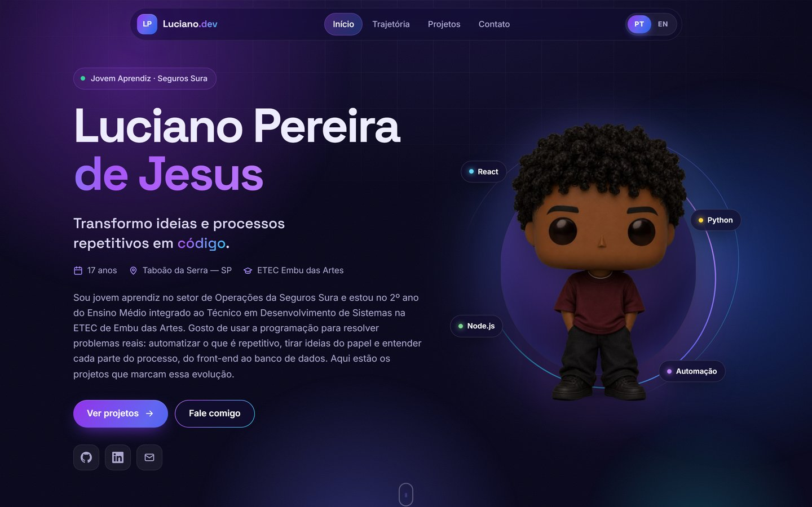

# Portfólio — Luciano Pereira

Portfólio pessoal feito com HTML, CSS e JavaScript, sem frameworks. Reúne meus projetos, minha trajetória e meus contatos, em português e inglês.

**Acesse:** https://lucianopdev.netlify.app



## Destaques

- Projetos carregados de um único arquivo (`data/projetos.json`), com filtro por categoria e vídeos de demonstração
- Tradução PT/EN sem recarregar a página
- Painel de conteúdo em `/admin` (Sveltia CMS) para editar projetos sem mexer no código
- Layout responsivo, metadados para SEO e redes sociais, e cabeçalhos de segurança configurados no `netlify.toml`

## Tecnologias

HTML5 · CSS3 · JavaScript · Sveltia CMS · Netlify

## Estrutura

```
index.html
assets/
  css/          Estilos
  js/main.js    Idioma, filtros e renderização dos projetos
  img/          Avatar, ícones e imagem de compartilhamento
  uploads/      Capas e vídeos dos projetos
data/
  projetos.json Conteúdo dos projetos
admin/          Painel de conteúdo
projetos/       Projetos hospedados junto com o portfólio
```

## Rodando localmente

Os projetos são carregados por `fetch`, então o site precisa de um servidor local:

```bash
python -m http.server 8000
```

Depois abra http://localhost:8000.
